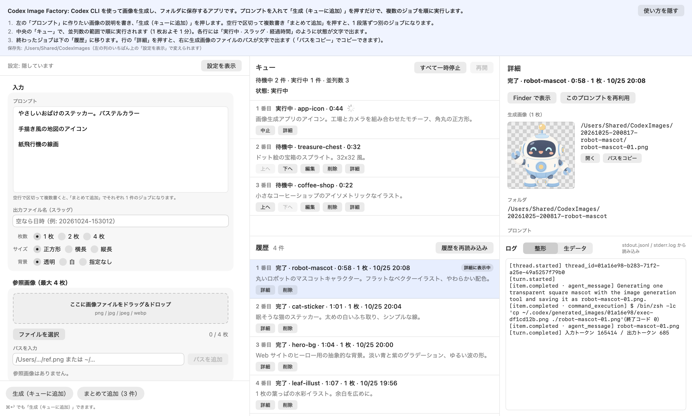

<p align="center"></p>

# Codex Image Factory

[English](README.md) | 日本語



ChatGPT のサブスクリプションでログイン済みの Codex CLI（`codex exec`）を裏で呼び出して、画像アセットを続けてたくさん作る macOS アプリ。OpenAI の公式アプリではない。
プロンプトをキューに積むと、並列数の範囲で `codex exec` を同時に走らせ、結果をフォルダに貯めて履歴に残す。OpenAI の API キーは使わない。

- 人間はプロンプトを次々と書いて離席できる（並列実行・キューの永続化・終わったら通知）
- AI エージェント（Claude のコンピュータ操作など）も、アクセシビリティ API 経由で同じ画面を操作できる（後述）

画面は日本語と英語に対応している（macOS の言語設定に従う）。ウィンドウのいちばん上には、初めて操作する人や AI エージェント向けの使い方を常に出している。

要件は「Codex 画像生成アプリ 要件定義」、着手前に実機で確かめた Codex の挙動は [docs/VERIFICATION.md](docs/VERIFICATION.md) にまとめた。

## 必要なもの

- macOS 15 以降、Xcode 16 以降（Xcode 27.1 / Swift 6.4 で確認）
- Codex CLI（codex-cli 0.164.0 で確認）。ChatGPT でログイン済みであること

```bash
codex login status
```

`Logged in using ChatGPT` と出れば準備完了。出なければ、ターミナルで `codex login` を実行する。アプリはログインに関与しない。

## インストール

[Releases](https://github.com/kkosuge/codex-image-factory/releases/latest) から `Codex-Image-Factory-<版>.zip` をダウンロードし、
展開した `Codex Image Factory.app` を `/Applications` に入れる。配布版は Developer ID で署名・公証してある。

アップデートは自動。1 日 1 回確認し、新しい版があれば裏でダウンロードして、アプリを終了したときに入れ替える
（[Sparkle](https://sparkle-project.org/) を使う。ウィンドウやアラートは出さず、状態は設定の「アップデート」に文字で出る）。
配布の仕組みとリリースの手順は [docs/RELEASING.md](docs/RELEASING.md) にまとめた。

## ソースからビルドする

```bash
xcodebuild -project CodexImageFactory.xcodeproj -scheme CodexImageFactory -configuration Release -derivedDataPath build/DerivedData build
```

```bash
cp -R "build/DerivedData/Build/Products/Release/Codex Image Factory.app" /Applications/
```

Xcode で `CodexImageFactory.xcodeproj` を開いて実行してもよい。署名はローカル実行用（ad-hoc）。開発者アカウントで署名したい場合は、ターゲットの Signing でチームを選ぶ。
App Sandbox はオフ（ユーザーの `codex` を起動し、`~/.codex` を読み、任意のフォルダに書くため）。App Store 配布はしない。

外部パッケージは Sparkle（自動アップデート）だけ。署名の検証などを自前で作り直さないために使う。
自分でビルドした版（Debug、または公開鍵を設定していない Release）では自動アップデートは動かない。

## 使い方

画面は 1 ウィンドウで、左に入力、中央にキュー（上）と履歴（下）、右に選んだジョブの詳細とログ。

1. 左の「プロンプト」に書き、必要なら出力ファイル名（スラッグ）・枚数（1 / 2 / 4）・サイズ（正方形 / 横長 / 縦長）・背景（透明 / 白 / 指定なし）・参照画像（最大 4 枚）を選ぶ
2. 「生成（キューに追加）」を押す。入力欄はすぐ空になるので、続けて次を書ける
   - 空行で区切って複数書き「まとめて追加」を押すと、1 段落 1 ジョブで積まれる
3. キューは先頭から順に、並列数（既定 3）まで同時に実行する
   - 待機中のジョブは「上へ」「下へ」「編集」「削除」、実行中は「中止」（SIGINT → 3 秒後 SIGKILL）
   - 「すべて一時停止」で新しい起動を止める（実行中のものは最後まで走る）。「再開」で続ける
   - レート制限らしきエラーを見つけると、自動で一時停止してバナーで知らせる。自動リトライはしない
4. 終わったジョブは履歴に移る。キューが空になったら macOS の通知を 1 回出す
5. 履歴の行の「詳細」で、右に生成画像（パスは文字で表示）・プロンプト・コマンド・ログを出す
   - 「このプロンプトを再利用」「コマンドをコピー」「Finder で表示」「再試行」（失敗・中止のとき）
   - 履歴の「削除」は記録だけを消し、画像は残す

アプリを終了しても待機中のジョブは残り、次に起動したときに一時停止状態で戻る（「再開」を押すと実行する）。
実行中に終了した場合は、そのジョブを中止し、同じ内容の待機中ジョブとして先頭に戻す。

アプリは 1 つだけ起動できる（2 つ目を開くと、すでに動いている方が前面に出る）。キューや履歴のファイルを取り合わないため。

## 保存されるもの

ジョブ 1 件 = フォルダ 1 つ。中身はフォルダ側を正とし、アプリの索引を消しても出力ディレクトリを走査して履歴を復元できる。

```
~/Pictures/CodexImages/            ← 出力ディレクトリ（設定で変更可）
  20261024-153012-kina-mascot/
    run.json          ← 実行の記録（コマンド・プロンプト・終了コード・画像のパスなど）
    prompt.txt        ← Codex に渡した最終プロンプト
    stdout.jsonl      ← codex の JSONL 出力そのまま
    stderr.log
    last-message.md   ← Codex の最終メッセージ
    kina-mascot-01.png
```

| 場所 | 内容 |
| --- | --- |
| `~/Library/Application Support/CodexImageFactory/queue.json` | 待機中のジョブ |
| `~/Library/Application Support/CodexImageFactory/history.json` | 履歴フォルダの索引 |
| `~/Library/Application Support/CodexImageFactory/failed/` | 出力ディレクトリに書けずに失敗したジョブの記録（再試行用） |
| UserDefaults（`company.kina.CodexImageFactory`） | 設定 |

## 設定

左の列のいちばん上の「設定を表示」で開く（メニューの ⌘, でも開ける）。

出力ディレクトリ・codex のパス・モデル・固定の指示文は、入力途中の値が実行中のキューに渡らないよう、
Return を押すか、ほかの欄へ移るか、「設定の変更を反映」を押したときに確かめてから反映する（固定の指示文は打ち終えて 1 秒たっても反映する）。
正しくない値は理由を赤字で出し、反映しない。

| 項目 | 既定 | 内容 |
| --- | --- | --- |
| 出力ディレクトリ | `~/Pictures/CodexImages` | パスを直接入力できる（フォルダ選択は補助） |
| codex のパス | 空（自動検出） | 空ならログインシェル（`zsh -lc` → `zsh -lic`）で探す |
| 並列数 | 3 | 1〜8 |
| タイムアウト | 10 分 | 超えたら中止と同じ手順で止めて失敗にする |
| モデル | 空 | `-m` に渡す。空なら Codex の既定 |
| 推論の強さ | 既定 | `-c model_reasoning_effort=...` |
| `--ephemeral` | オフ | Codex のセッション履歴を残さない |
| スタイルプリセット | 空 | プロンプトの先頭に付ける定型文 |
| 固定の指示文 | 下記 | Codex の挙動が変わったら、再ビルドせずにここを直す |

固定の指示文では `{count}` `{filenames}` `{slug}` `{size}` `{background}` が置き換わる。プロンプトは「スタイルプリセット → プロンプト本文 → 固定の指示文」の順に連結して渡す。

実行するコマンドは次の形（履歴の「コマンドをコピー」で、シェルにそのまま貼れる 1 行が得られる）。

```
codex exec -C <ジョブのフォルダ> -s workspace-write --skip-git-repo-check --json \
  -o <ジョブのフォルダ>/last-message.md [-m …] [-c …] [--ephemeral] [-i <参照画像> …] -- '<プロンプト>'
```

生成画像はフォルダの差分で見つける。Codex が作業フォルダにコピーしなかった場合は、`~/.codex/generated_images/<thread_id>/` から取り出して同じ命名規則で保存する。

## AI エージェントから操作する

アクセシビリティ API で、アプリを前面に出さずに操作できるように作ってある。

- プルダウン・ポップアップメニュー・シート・アラート・右クリック専用・ホバー専用の操作は無い。選択肢はラジオボタンかセグメント
- すべての操作部品に日本語のラベルと識別子がある。行ごとのボタンのラベルには行の番号とスラッグが入る（例: `削除: 2 番目 kina-mascot`）
- キューと履歴の行は画面外にあってもアクセシビリティツリーに出る（履歴は新しい 300 件まで。「さらに表示」で増やす）
- 設定の入力欄は「設定の変更を反映」ボタンでも反映できる（Return やフォーカス移動を送らなくてよい）
- 状態は文字で出る（例: `待機中 · kina-mascot · 0:42`）。生成画像のパスは選択できる文字で出る
- プロンプト欄は標準の `TextEditor`

主な識別子:

| 識別子 | 部品 |
| --- | --- |
| `input.prompt` / `input.slug` | プロンプト / スラッグ |
| `input.count` / `input.aspect` / `input.background` | 枚数 / サイズ / 背景 |
| `input.reference.pathField` / `input.reference.addPath` | 参照画像のパス入力 / 追加 |
| `input.submit` / `input.submitBatch` | 生成（キューに追加）/ まとめて追加 |
| `queue.pauseAll` / `queue.resumeAll` | すべて一時停止 / 再開 |
| `queue.row.<id>` / `history.row.<id>` | キュー・履歴の行（`.detail` `.cancel` `.retry` `.delete` などが続く） |
| `detail.status` / `detail.imagePath.<n>` / `detail.command` | 詳細の状態 / 画像のパス / コマンド |
| `detail.copyCommand` / `detail.revealInFinder` / `detail.reusePrompt` | コマンドをコピー / Finder で表示 / 再利用 |
| `settings.toggle` / `settings.applyDrafts` | 設定を表示・隠す / 設定の変更を反映 |
| `history.showMore` | 履歴をさらに表示 |

## テスト

```bash
xcodebuild -project CodexImageFactory.xcodeproj -scheme CodexImageFactory -destination 'platform=macOS,arch=arm64' test
```

- `codex` は `CodexRunning` プロトコルの裏にあり、テストでは PNG を書くだけのダミースクリプトに差し替える
- `IntegrationTests`: 本物のプロセス実行・キュー・実行部品をダミー codex でつなぎ、5 件を並列数 3 で消化する受け入れ条件などをなぞる
- `UIAuditTests`: 画面を画面外で描画してアクセシビリティツリーを確かめ、UI のソースからメニュー・シートなどの禁止部品と識別子の付け忘れを探す
- `RealCodexTests`: 本物の codex で 5 件を生成する受け入れテスト。サブスクリプションの枠を使うので、普段は飛ばす

```bash
TEST_RUNNER_CIF_REAL_CODEX=1 TEST_RUNNER_CIF_REAL_OUTPUT_DIR=~/Pictures/CodexImages-test xcodebuild -project CodexImageFactory.xcodeproj -scheme CodexImageFactory -destination 'platform=macOS,arch=arm64' test -only-testing:CodexImageFactoryTests/RealCodexTests
```

## 構成

| フォルダ | 内容 |
| --- | --- |
| `Models/` | ジョブの記録（`JobRecord`）と設定（`AppSettings`） |
| `Core/` | プロンプト組み立て・コマンド生成・シェルクォート・画像検出・JSONL の整形・レート制限の検出 |
| `Process/` | `codex` の起動（行単位の出力・中止・タイムアウト）とパス・ログイン状態の確認 |
| `Queue/` | キュー（actor）・1 ジョブの実行・フォルダと run.json・キューと履歴の保存 |
| `AppModel/` | 画面の状態（`@MainActor @Observable`）と設定の保存・通知・自動アップデート |
| `UI/` | SwiftUI の画面 |
| `Config/Info.plist` | Sparkle の設定（appcast の URL・公開鍵） |
| `scripts/release/` | 配布用のビルド・署名・公証・appcast の更新・Pages への公開 |
| `.github/workflows/` | テスト（`ci.yml`）とリリース（`release.yml`） |

## 名前について

アプリ名は「Codex Image Factory」、Dock での表示名は「Image Factory」、バンドル ID は `company.kina.CodexImageFactory`。
Codex を画像生成のエンジンとして使う、OpenAI とは関係のない非公式のツール。Codex は OpenAI の商標。

## ライセンス

[MIT](LICENSE)。Sparkle は Sparkle 自身の [MIT 系のライセンス](https://github.com/sparkle-project/Sparkle/blob/2.x/LICENSE)で配布されている。
Codex は OpenAI の商標で、このプロジェクトは OpenAI とは関係がない。
