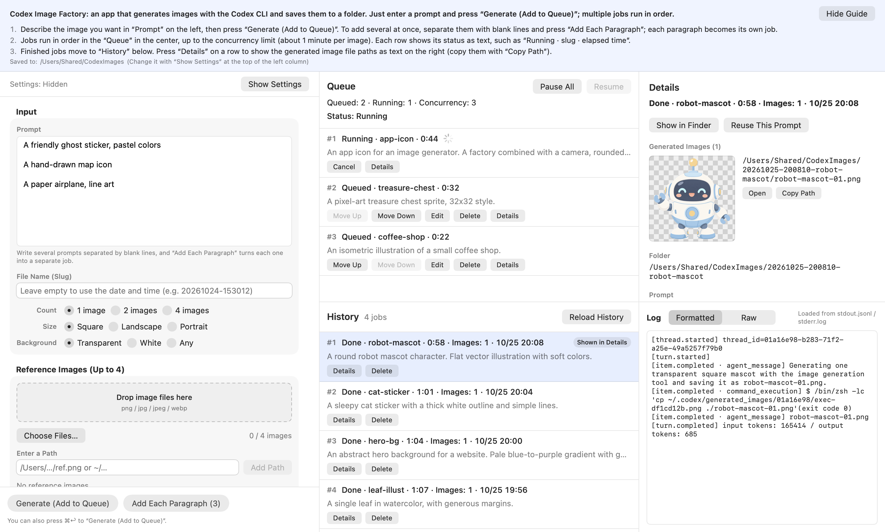
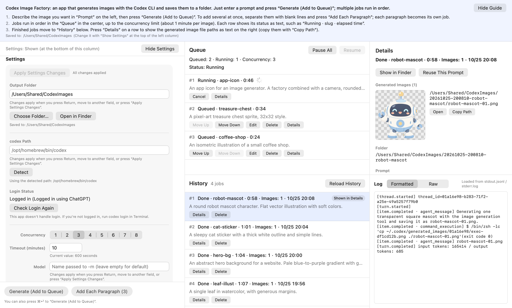

<p align="center"></p>

# Codex Image Factory

English | [日本語](README.ja.md)

A macOS app that turns the [Codex CLI](https://github.com/openai/codex) into an image-asset factory.
Queue up prompts, and it runs `codex exec` in parallel, saves every image into its own folder, and keeps a full history of what was run.
It uses your ChatGPT subscription through the Codex CLI — no OpenAI API key.



> **Unofficial.** Codex Image Factory is not made by or affiliated with OpenAI. Codex is a trademark of OpenAI.

## Why

ChatGPT makes one image per conversation, so producing a batch of mascots, stickers, icons or backgrounds means juggling many chats.
Codex Image Factory lets you write ten prompts, walk away, and come back to ten folders of PNGs — each with the exact command, prompt and log that produced it.

It is also built to be driven by AI agents (for example, Claude's computer use) through the macOS Accessibility API, in the background.

## Features

- **Queue with parallel runs** — add prompts one at a time or several at once (one per paragraph). Runs up to 1–8 jobs at a time (default 3).
- **Reorder, edit, delete, pause, resume, cancel** queued and running jobs. Failed jobs can be retried with one click; nothing is retried automatically.
- **Rate-limit aware** — if Codex reports a rate limit, the queue pauses itself and tells you.
- **Survives restarts** — waiting jobs are saved and come back paused when you relaunch.
- **One folder per job** with `run.json`, `prompt.txt`, `stdout.jsonl`, `stderr.log`, the last message and the images. History can be rebuilt from the folders alone.
- **Reuse, copy, reveal** — reuse a prompt, copy the exact `codex exec` command as one shell-ready line, or show the images in Finder.
- **Options** — count (1/2/4), size (square/landscape/portrait), background (transparent/white/any), up to 4 reference images, a style preset, model and reasoning effort.
- **Notifications** when the whole queue is done.
- **English and Japanese** UI (follows your macOS language).
- **Automatic updates** via [Sparkle](https://sparkle-project.org/), silently installed when you quit — no update windows.

## Requirements

- macOS 15 or later
- The [Codex CLI](https://github.com/openai/codex), signed in with ChatGPT:

```bash
codex login status
```

If it doesn't say `Logged in using ChatGPT`, run `codex login` in Terminal. The app never touches your credentials.

## Install

Download `Codex-Image-Factory-<version>.zip` from [Releases](https://github.com/kkosuge/codex-image-factory/releases/latest), unzip it, and move **Codex Image Factory.app** to `/Applications`.
Release builds are signed with Developer ID and notarized by Apple.

The app checks for updates once a day, downloads new versions in the background and installs them when you quit.
The status is shown as text under **Settings → Updates**.

## Usage

1. Describe the image in **Prompt** and press **Generate (Add to Queue)** (or ⌘↩). The field clears right away so you can write the next one.
   Write several paragraphs separated by blank lines and press **Add Each Paragraph** to queue one job per paragraph.
2. Optionally set the **File Name (Slug)**, **Count**, **Size**, **Background**, **Reference Images** and **Style Preset**.
3. Jobs run from the **Queue**, up to the concurrency limit. Each row reads like `Running · robot-mascot · 0:42`. One image takes about a minute.
4. Finished jobs move to **History**. Press **Details** to see the images, their full paths (as selectable text), the prompt sent to Codex, the command and the log.



### Settings

Open them with **Show Settings** at the top of the left column (or ⌘,).

| Setting | Default | |
| --- | --- | --- |
| Output Folder | `~/Pictures/CodexImages` | Type a path or choose a folder. |
| codex Path | auto-detect | Found through your login shell (`zsh -lc`, then `zsh -lic`). |
| Concurrency | 3 | 1–8 jobs at a time. |
| Timeout | 10 minutes | A job that runs longer is stopped and marked failed. |
| Model | Codex default | Passed as `-m`. |
| Reasoning Effort | Codex default | Passed as `-c model_reasoning_effort=…`. |
| `--ephemeral` | off | Don't keep Codex session files. |
| Style Preset | empty | Text prepended to every prompt. |
| Fixed Instructions | built in | The instruction appended to every prompt. `{count}` `{filenames}` `{slug}` `{size}` `{background}` are replaced. Edit it if Codex changes its behavior. |

Path-like settings are applied when you press Return, move to another field, or press **Apply Settings Changes**, so half-typed paths never reach running jobs.

## Where things are saved

```
~/Pictures/CodexImages/
  20261024-153012-kina-mascot/
    run.json          ← the full record: command, prompt, exit code, image paths, …
    prompt.txt        ← the exact prompt sent to Codex
    stdout.jsonl      ← Codex's JSONL output, as is
    stderr.log
    last-message.md   ← Codex's final message
    kina-mascot-01.png
```

| Location | Contents |
| --- | --- |
| `~/Library/Application Support/CodexImageFactory/queue.json` | Waiting jobs |
| `~/Library/Application Support/CodexImageFactory/history.json` | Index of history folders |
| `~/Library/Application Support/CodexImageFactory/failed/` | Records of jobs that couldn't write to the output folder |
| UserDefaults (`company.kina.CodexImageFactory`) | Settings |

## How it works

For each job the app creates a folder and runs:

```
codex exec -C <job folder> -s workspace-write --skip-git-repo-check --json \
  -o <job folder>/last-message.md [-m …] [-c …] [--ephemeral] [-i <reference> …] -- '<prompt>'
```

The prompt is the style preset, your prompt and the fixed instructions, joined in that order.
New images are found by comparing the folder before and after the run. If Codex didn't copy an image into the folder, the app picks it up from `~/.codex/generated_images/<thread_id>/`.
A job fails if `codex` exits with a non-zero code or no image was produced.
Notes from testing the Codex CLI before building the app are in [docs/VERIFICATION.md](docs/VERIFICATION.md) (Japanese).

## For AI agents

The UI is designed to be operated through the Accessibility API without bringing the app to the front:

- A short how-to is always shown at the top of the window.
- No pull-down or pop-up menus, sheets, alerts, right-click-only or hover-only actions. Choices are radio buttons or segmented controls; file dialogs are only shortcuts next to text fields.
- Every control has a readable label and a stable identifier. Row buttons include the row number and slug, e.g. `Delete: #2 kina-mascot`.
- States are text (`Queued · kina-mascot · 0:42`), and generated image paths are selectable text.
- The prompt field is a standard `TextEditor`.

Useful identifiers:

| Identifier | Control |
| --- | --- |
| `guide` | The how-to at the top |
| `input.prompt` / `input.slug` | Prompt / file name (slug) |
| `input.count` / `input.aspect` / `input.background` | Count / size / background |
| `input.reference.pathField` / `input.reference.addPath` | Reference image path / add |
| `input.submit` / `input.submitBatch` | Generate / add each paragraph |
| `queue.pauseAll` / `queue.resumeAll` | Pause all / resume |
| `queue.row.<id>` / `history.row.<id>` | Queue and history rows (`.detail`, `.cancel`, `.retry`, `.delete`, …) |
| `detail.status` / `detail.imagePath.<n>` / `detail.command` | Status / image path / command |
| `detail.copyCommand` / `detail.revealInFinder` / `detail.reusePrompt` | Copy command / show in Finder / reuse prompt |
| `settings.toggle` / `settings.applyDrafts` | Show or hide settings / apply settings changes |

## Build from source

Requires Xcode 16 or later.

```bash
xcodebuild -project CodexImageFactory.xcodeproj -scheme CodexImageFactory -configuration Release -derivedDataPath build/DerivedData build
```

```bash
cp -R "build/DerivedData/Build/Products/Release/Codex Image Factory.app" /Applications/
```

Local builds are ad-hoc signed, and automatic updates are disabled in them. App Sandbox is off, because the app runs your `codex` binary, reads `~/.codex` and writes to any folder you choose.
The only third-party dependency is Sparkle.

### Tests

```bash
xcodebuild -project CodexImageFactory.xcodeproj -scheme CodexImageFactory -destination 'platform=macOS' test
```

- `codex` sits behind a protocol; tests swap in a dummy script that writes a PNG.
- `IntegrationTests` wire the real process runner, executor and queue to that dummy and run five jobs with concurrency 3.
- `UIAuditTests` render the window off-screen and scan the UI sources for forbidden controls and missing identifiers.
- `LocalizationTests` check that every string has an English translation with matching placeholders.
- `RealCodexTests` generate real images with your Codex subscription and are skipped unless `CIF_REAL_CODEX=1`.

### Localization

Strings live in `CodexImageFactory/Localizable.xcstrings` (Japanese is the source language).
Xcode updates the catalog when you build in the IDE; from the command line run `scripts/l10n/sync-strings.sh`.

### Releasing

Pushing a `v1.2.3` tag builds, signs, notarizes and publishes the release and the Sparkle appcast with GitHub Actions.
See [docs/RELEASING.md](docs/RELEASING.md) (Japanese).

## Project layout

| Folder | |
| --- | --- |
| `CodexImageFactory/Models` | Job record and settings |
| `CodexImageFactory/Core` | Prompt building, command line, shell quoting, image detection, log formatting, rate-limit detection |
| `CodexImageFactory/Process` | Running `codex` (line streaming, cancel, timeout), finding it, login status |
| `CodexImageFactory/Queue` | The queue (an actor), running one job, job folders, saving the queue and history |
| `CodexImageFactory/AppModel` | UI state, settings, notifications, updates |
| `CodexImageFactory/UI` | SwiftUI views |
| `scripts/` | Release and localization scripts |

## License

[MIT](LICENSE). Sparkle is distributed under its own [MIT-style license](https://github.com/sparkle-project/Sparkle/blob/2.x/LICENSE).
Codex is a trademark of OpenAI; this project is not affiliated with OpenAI.
